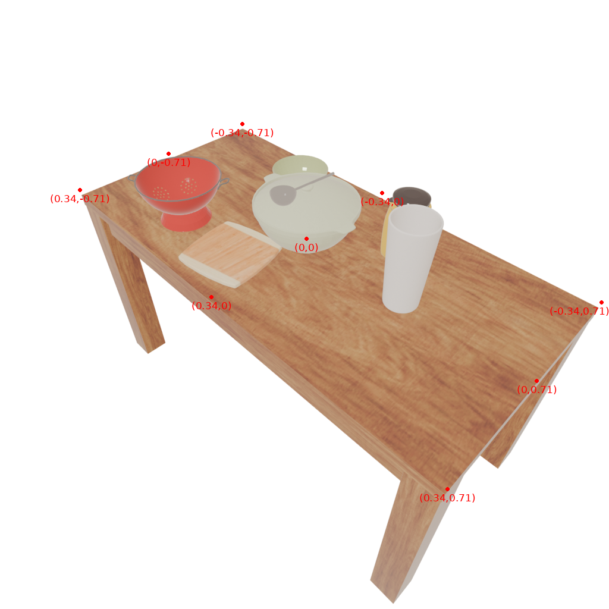
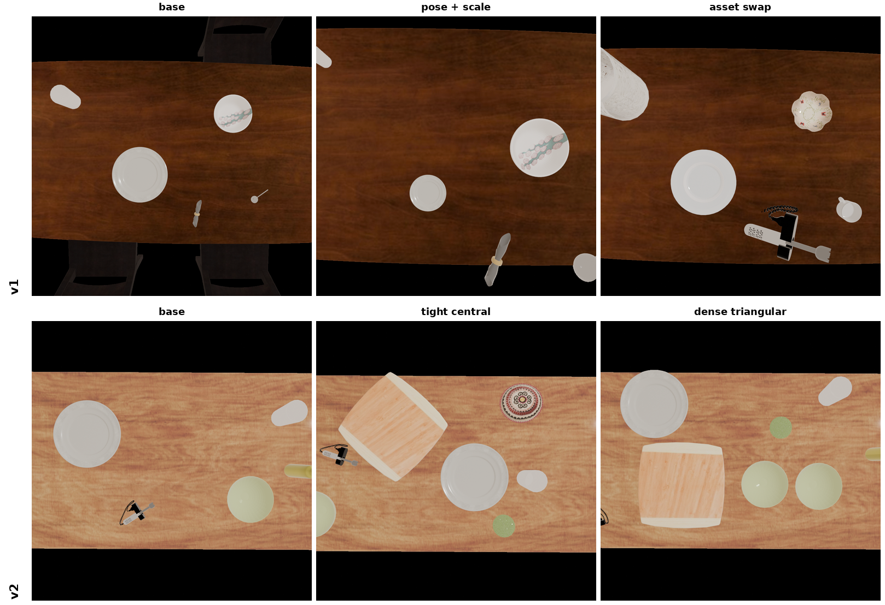

# TaskSmith: Task-Prompted RL Environment Generation

TaskSmith extends [SceneSmith](https://arxiv.org/abs/2602.09153) for indoor manipulation tasks. It conditions scene layout and object selection on a natural-language task prompt, and outputs structured RL artifacts alongside each scene: task requirements, reward specification, and a domain randomization spec. A domain randomization pipeline then produces N task-valid variants from a single base scene, amortizing generation cost across a training batch.

## Repository layout

| Path | Contents |
|------|----------|
| `scenesmith/` | Core pipeline and agent modules |
| `scripts/` | Experiment analysis, export, and rendering utilities |
| `configurations/` | Hydra config groups (agents, provider, experiment) |
| `experiments/configs/` | Self-contained config bundles for reproducing paper runs |
| `docs/` | Full documentation (MkDocs) |

---

## Installation

Requires Python 3.11 and [uv](https://docs.astral.sh/uv/).

```bash
uv sync
```

Blender is required for rendering and is invoked in-process via the `bpy` Python module included in `uv sync`.

Drake is installed as a Python dependency for physics simulation and is included in `uv sync`.

**Dataset and asset setup** (HSSD models, Objaverse assets, material library, precomputed embeddings): see [`scenesmith/README.md`](scenesmith/README.md).

## Provider setup (EPFL RCP)

```bash
export PROVIDER_BASE_URL=https://inference.rcp.epfl.ch/v1
export PROVIDER_MODEL=Qwen/Qwen3.6-27B-FP8
export PROVIDER_API_KEY=<your-rcp-key>
```

Create a `.env` file at the repo root with these values, or set them in your shell. The pipeline reads them at startup via `load_project_dotenv()`.

## Reproducing the paper experiments

### A. Standard task-aware scene generation

Kitchen scene:

Task prompt (Appendix B):
> A compact kitchen-dining area with a fixed stone countertop along one wall, a wooden sideboard, a tall potted plant in one corner, and a rectangular dining table with four chairs. On the table: a dinner plate, a bowl, a glass, a fork, and a knife. On the countertop: a cutting board, a sponge, and a small pot. Task: arrange the plate, bowl, glass, fork, and knife in a proper place setting on the table.

```bash
uv run python main.py \
  --config-path experiments/configs/E0_baseline \
  +name=kitchen_c3 \
  "experiment.prompts=['A compact kitchen-dining area with a fixed stone countertop along one wall, a wooden sideboard, a tall potted plant in one corner, and a rectangular dining table with four chairs. On the table: a dinner plate, a bowl, a glass, a fork, and a knife. On the countertop: a cutting board, a sponge, and a small pot. Task: arrange the plate, bowl, glass, fork, and knife in a proper place setting on the table.']"
```

### B. Multi-scene generalization

Office scene:

```bash
uv run python main.py \
  --config-path experiments/configs/E0_baseline \
  +name=office \
  "experiment.prompts=['A compact home office with a wooden writing desk along one wall, an office chair in front of it, a two-shelf bookcase against the opposite wall, and a small filing cabinet in one corner. On the desk: a laptop computer, a ceramic coffee mug, a pen holder with several pens, and a spiral-bound notebook. Task: clear the desk surface by placing the coffee mug on the bookcase shelf and the notebook next to the filing cabinet.']"
```

Living room scene:

```bash
uv run python main.py \
  --config-path experiments/configs/E0_baseline \
  +name=living_room \
  "experiment.prompts=['A cozy living room with a three-seat sofa along one wall, a rectangular coffee table centered in front of it, and a tall bookshelf against the opposite wall. Scattered on the sofa: three hardcover books and a paperback novel. Task: pick up each book from the sofa and place it upright on the bookshelf.']"
```

### C. Tabletop mode

Tabletop mode generates a flat-floor scene with one LLM-placed table and manipulands, skipping walls, ceiling, and full room enclosure.

Research desk:

```bash
uv run python main.py \
  +name=tabletop_desk \
  experiment=tabletop \
  manipuland_agent=tabletop_manipuland_agent \
  furniture_agent=tabletop_furniture_agent \
  "experiment.prompts=['A researcher'\''s desk with a laptop, a ceramic mug, a spiral notebook, and a pen. Task: place the mug to the right of the laptop and the notebook in front of it.']"
```

Kitchen prep table:

```bash
uv run python main.py \
  +name=tabletop_kitchen \
  experiment=tabletop \
  manipuland_agent=tabletop_manipuland_agent \
  furniture_agent=tabletop_furniture_agent \
  "experiment.prompts=['A kitchen prep table with a cutting board, a knife, two tomatoes, and a bowl. Task: place the tomatoes on the cutting board and the knife beside it.']"
```


*Left: research desk. Right: kitchen prep table.*

### D. Domain randomization

Domain randomization generates N task-valid variants from a completed base scene. Pass the path to the base experiment directory (the folder containing `scene_000/`).

**v1 (programmatic):**

```bash
uv run python -m scenesmith.domain_randomization.cli \
  +name=dr_batch_v1 \
  +domain_randomization.base_experiment_dir=outputs/YYYY-MM-DD/<run> \
  +domain_randomization.num_variations=10 \
  domain_randomization.mode=deterministic
```

**v2 (agentic):**

```bash
uv run python -m scenesmith.domain_randomization.cli \
  +name=dr_batch_v2 \
  +domain_randomization.base_experiment_dir=outputs/YYYY-MM-DD/<run> \
  +domain_randomization.num_variations=10 \
  domain_randomization.mode=agentic \
  '+domain_randomization.description=vary object placement and clutter level'
```


*Top row: v1 (programmatic) variants. Bottom row: v2 (agentic) variants.*

## Outputs

Each run produces a timestamped directory under `outputs/YYYY-MM-DD/<name>_HH-MM-SS_microseconds/`. Inside it, `scene_000/` (and `scene_001/`, etc. for multi-scene runs) contains:

| File | Contents |
|------|----------|
| `task_requirements.json` | Structured task spec: required objects and placement stages |
| `rl_artifacts.json` | Resolved object IDs and support surface positions |
| `reward_spec.yaml` | Dense reward function specification |
| `combined_house/house.dmd.yaml` | Full scene descriptor |
| `combined_house/house.blend` | Blender scene file for rendering |

Files `rl_artifacts.json`, `reward_spec.yaml`, and `morphology_task_config.json` are produced only when the pipeline runs through the `morphology_task` stage. They are absent from tabletop-mode runs and from runs stopped before that stage.

## Documentation

Full documentation is in `docs/`. Build it locally with:

```bash
uv run mkdocs serve
```
