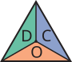

<h1 align="center">
  &nbsp;scenesmith
</h1>

<p align="center">
Scene generation pipeline module for TaskSmith, forked from
<a href="https://github.com/nepfaff/scenesmith">nepfaff/scenesmith</a>
("SceneSmith: Agentic Generation of Simulation-Ready Indoor Scenes").
</p>

<p align="center">
  <a href="https://arxiv.org/abs/2602.09153"></a>
  <a href="https://scenesmith.github.io/"></a>
  <a href="https://youtu.be/V5Sg2NPqJb8"></a>
  <a href="../LICENSE"></a>
</p>

> This directory contains the upstream SceneSmith pipeline, extended for TaskSmith. TaskSmith-specific additions include task-aware generation, domain randomization, tabletop mode, and provider abstraction (see [root README](../README.md)). Setup instructions below are from the upstream [nepfaff/scenesmith](https://github.com/nepfaff/scenesmith) repository.

---

## Table of Contents

- [Installation](#-installation)
  - [Local Install](#local-install)
  - [Multi-GPU Rendering](#multi-gpu-rendering-support-optional)
  - [Asset Generation Backends](#asset-generation-backends)
  - [Environment Variables](#environment-variables)
  - [Docker](#-docker)
- [Data Setup](#-data-setup)
  - [HSSD](#hssd-dataset-setup)
  - [Objaverse](#objaverse-objectthor-setup)
  - [Articulated Objects](#articulated-object-datasets)
  - [AmbientCG Materials](#ambientcg-pbr-materials)
- [Scene Generation](#-scene-generation)
  - [Multi-GPU Support](#multi-gpu-support)
  - [Pipeline Stage Control](#pipeline-stage-control)
  - [Branching](#branching-from-a-previous-experiment)
- [Visualization](#-visualization)
- [Export](#-export)
- [Testing](#-testing)
- [License](#-license)

---

## 📦 Installation

> For Docker-based setup with GPU support, see [Docker](#-docker) below.

### Local Install

This repository uses [uv](https://docs.astral.sh/uv) for dependency management.

Install uv:
```sh
curl -LsSf https://astral.sh/uv/install.sh | sh
```

Install the dependencies (including dev tools like pytest) into `.venv`:
```sh
uv sync
```

To install without dev dependencies:
```sh
uv sync --no-dev
```

Activate the virtual env:
```sh
source .venv/bin/activate
```

> **Important:** Installation is not complete yet. The default configuration requires
> additional data and model checkpoints. After installing dependencies, continue with:
> 1. [SAM3D Backend](#sam3d-backend) - 3D asset generation (default backend)
> 2. [Articulated Objects (ArtVIP)](#artvip-setup) - Articulated furniture
> 3. [AmbientCG Materials](#ambientcg-pbr-materials) - PBR materials

### Multi-GPU Rendering Support (Optional)

For distributing Blender rendering across multiple GPUs, install bubblewrap:

```sh
# Ubuntu/Debian
sudo apt-get install bubblewrap
```

### Asset Generation Backends

SceneSmith supports two backends for open-set 3D asset generation. If using
`strategy: "hssd"` (retrieval from HSSD library), no generation backend is needed.

#### Hunyuan3D-2 Backend

Lower-quality asset generation, fits into 24 GB GPU memory.

1. **Install submodules**:
   ```sh
   git submodule update --init --recursive
   ```

2. **Install Hunyuan3D-2**:
   ```sh
   bash scripts/install_hunyuan3d.sh
   ```

3. **Enable in configuration**:
   ```yaml
   asset_manager:
     backend: "hunyuan3d"
   ```

#### SAM3D Backend

Higher-quality asset generation, requires 32 GB GPU memory. **Used in the paper.**

1. **Request access** to [SAM-3D](https://huggingface.co/facebook/sam-3d-objects) and [SAM3](https://huggingface.co/facebook/sam3) on HuggingFace (auto-approval ~30 min).

2. **Authenticate**:
   ```sh
   huggingface-cli login
   ```

3. **Install SAM3D**:
   ```sh
   bash scripts/install_sam3d.sh
   ```

4. **Enable in configuration**:
   ```yaml
   asset_manager:
     backend: "sam3d"
   ```

### Environment Variables

```sh
# Required (upstream default): OpenAI API key for LLM agents and default image generation
export OPENAI_API_KEY="your-openai-key"

# Optional: Google API key for Gemini image generation backend
export GOOGLE_API_KEY="your-google-key"

# Optional: Separate API key for OpenAI Agents tracing
export OPENAI_TRACING_KEY="your-tracing-key"
```

> **TaskSmith note:** TaskSmith uses `PROVIDER_BASE_URL` / `PROVIDER_API_KEY` / `PROVIDER_MODEL` instead of `OPENAI_API_KEY`. See the [provider setup section](../README.md#provider-setup-epfl-rcp) in the root README.

---

## 🐳 Docker

Run SceneSmith in a Docker container with NVIDIA GPU support.

### Prerequisites

- **Docker Engine** (apt-based, not snap): [official instructions](https://docs.docker.com/engine/install/ubuntu/).
- **NVIDIA Container Toolkit**:
  ```sh
  sudo nvidia-ctk runtime configure --runtime=docker
  sudo systemctl restart docker
  ```

### Build

```sh
docker build -t scenesmith .
```

### SAM3D Checkpoints

```sh
huggingface-cli login

mkdir -p external/checkpoints
huggingface-cli download facebook/sam3 sam3.pt --local-dir external/checkpoints
huggingface-cli download facebook/sam-3d-objects \
    --repo-type model \
    --local-dir external/checkpoints/sam-3d-objects-download \
    --include "checkpoints/*"
mv external/checkpoints/sam-3d-objects-download/checkpoints/* external/checkpoints/
rm -rf external/checkpoints/sam-3d-objects-download
```

### Run

```sh
docker compose run --rm scenesmith bash
# then inside:
python main.py +name=my_experiment
```

### Volume Mounts

| Host Path | Container Path | Content |
|-----------|---------------|---------|
| `./data/` | `/app/data/` | HSSD models, Objaverse assets, materials, preprocessed indices |
| `./external/checkpoints/` | `/app/external/checkpoints/` | SAM3D model weights |
| `./outputs/` | `/app/outputs/` | Generated scenes |

---

## 💾 Data Setup

The **default configuration** requires three data dependencies:

1. **SAM3D** - 3D asset generation backend (see [above](#sam3d-backend))
2. **ArtVIP** - Articulated furniture (cabinets, drawers, etc.)
3. **AmbientCG Materials** - PBR materials for walls, floors, and surfaces

HSSD, Objaverse, and PartNet-Mobility are optional alternative asset sources.

### HSSD Dataset Setup

1. **Accept the HSSD license** at https://huggingface.co/datasets/hssd/hssd-models

2. **Download HSSD models** (~72 GB, requires Git LFS):
   ```sh
   cd data
   git lfs install
   git clone git@hf.co:datasets/hssd/hssd-models
   ```

3. **Download preprocessed data** (~60 MB + ~2 GB):
   ```sh
   bash scripts/download_hssd_data.sh
   ```

   Or manually:
   ```sh
   wget https://github.com/3dlg-hcvc/hsm/releases/latest/download/data.zip
   unzip data.zip -d data/preprocessed

   wget https://github.com/3dlg-hcvc/hsm/releases/latest/download/support-surfaces.zip
   unzip support-surfaces.zip -d data/hssd-models
   ```

4. **Enable in configuration**:
   ```yaml
   asset_manager:
     strategy: "hssd"
   ```

### Objaverse (ObjectThor) Setup

1. **Download ObjectThor data** (~50 GB assets + ~200 MB features):
   ```sh
   bash scripts/download_objaverse_data.sh
   ```

2. **Preprocess for retrieval**:
   ```sh
   python scripts/prepare_objaverse.py
   ```

3. **Enable in configuration**:
   ```yaml
   asset_manager:
     general_asset_source: "objaverse"
   ```

### Articulated Object Datasets

#### ArtVIP Setup (recommended)

```sh
# Download VHACD variant (recommended; tighter collision geometries)
huggingface-cli download nepfaff/scenesmith-preprocessed-data \
    artvip/artvip_vhacd.tar.gz --repo-type dataset --local-dir .
mkdir -p data/artvip_sdf
tar xzf artvip/artvip_vhacd.tar.gz -C data/artvip_sdf
rm -rf artvip
```

#### PartNet-Mobility Setup

1. **Download** from https://sapien.ucsd.edu/downloads and extract to `data/partnet-mobility-v0/`.

2. **Convert to SDF format**:
   ```sh
   python scripts/convert_partnet_mobility.py \
       --input data/partnet-mobility-v0 \
       --output data/partnet_mobility_sdf
   ```

3. **Compute CLIP embeddings**:
   ```sh
   python scripts/compute_articulated_embeddings.py \
       --source partnet_mobility \
       --data-path data/partnet_mobility_sdf \
       --output-path data/partnet_mobility_sdf/embeddings
   ```

### AmbientCG PBR Materials

1. **Download materials**:
   ```sh
   python scripts/download_ambientcg.py --output data/materials
   ```

2. **Download pre-computed CLIP embeddings** (recommended):
   ```sh
   huggingface-cli download nepfaff/scenesmith-preprocessed-data \
       --repo-type dataset \
       --include "ambientcg/embeddings/**" \
       --local-dir data/scenesmith-preprocessed-data
   mv data/scenesmith-preprocessed-data/ambientcg/embeddings data/materials/embeddings
   rm -rf data/scenesmith-preprocessed-data
   ```

   Or compute yourself:
   ```sh
   python scripts/compute_ambientcg_embeddings.py --materials-dir data/materials
   ```

---

## 🎬 Scene Generation

```sh
python main.py +name=run_name
```

Set the scene prompts in `experiment.prompts` (`configurations/experiment/base_experiment.yaml`).

Requires ≥24 GB GPU memory for Hunyuan3D and ≥32 GB for SAM3D. We recommend ≥45 GB to run the full pipeline. All code was tested with an L40S GPU.

### Multi-GPU Support

The geometry generation server automatically uses all available GPUs. To control which GPUs:

```sh
CUDA_VISIBLE_DEVICES=0,1,2,3 python main.py +name=my_experiment
```

### Pipeline Stage Control

Seven stages run in order: `floor_plan` → `furniture` → `wall_mounted` → `ceiling_mounted` → `manipuland` → `reward_spec` → `morphology_task`.

```sh
# Stop after a specific stage
python main.py +name=my_experiment experiment.pipeline.stop_stage=furniture

# Resume from a later stage
python main.py +name=my_experiment experiment.pipeline.start_stage=manipuland
```

### Branching from a Previous Experiment

```sh
python main.py +name=branch_1 \
  experiment.pipeline.start_stage=manipuland \
  experiment.pipeline.resume_from_path=outputs/YYYY-MM-DD/<name>_HH-MM-SS_<uuid>
```

---

## 🔍 Visualization

### Intermediate Scenes

```sh
python -m pydrake.visualization.model_visualizer \
    outputs/YYYY-MM-DD/<name>_HH-MM-SS_<uuid>/scene_000/room_*/scene_renders/furniture_selection/scene.dmd.yaml
```

### Portable House Scenes

```sh
export ROS_PACKAGE_PATH=/path/to/outputs/YYYY-MM-DD/<name>_HH-MM-SS_<uuid>/scene_000:$ROS_PACKAGE_PATH
python -m pydrake.visualization.model_visualizer \
    outputs/YYYY-MM-DD/<name>_HH-MM-SS_<uuid>/scene_000/combined_house/house.dmd.yaml
```

---

## 📤 Export

### MuJoCo and USD

```sh
./scripts/setup_mujoco_export.sh
source .mujoco_venv/bin/activate

python scripts/export_scene_to_mujoco.py outputs/YYYY-MM-DD/<name>_HH-MM-SS_<uuid>/scene_000 -o mujoco_export
python -m mujoco.viewer --mjcf=mujoco_export/scene.xml
```

---

## 🧪 Testing

```sh
pytest tests/unit/ --testmon
pytest tests/integration/ --testmon
```

---

## 📄 License

MIT License. See [LICENSE](../LICENSE) for details.
